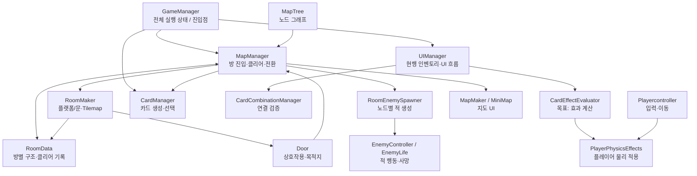
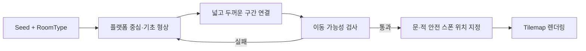

# 프로그램 구조 설계 — 리팩터링 초안

**기준일:** 2026-11-17  
**근거:** 대화에서 공유된 `MapManager`, `RoomMaker` 전문, `InventoryUI`/`InventoryCardUI`, `CardInstance` 구성 및 `RoomEnemySpawner`와 클리어 흐름.  
**범위 제한:** `Door`, `MapTree`, `Playercontroller`, `MiniMap`, 최신 `CardManager` 등의 전체 코드는 검토하지 못함. 아래 **목표 설계**를 구현 완료 상태로 오해하지 말 것.

## 1. 핵심 아키텍처



화살표는 '호출하거나 정보를 전달함'을 뜻하는 **개념적 의존 관계**이다. 모든 화살표가 현재 코드에 실제로 존재하는 것은 아니다. 특히 `CardEffectEvaluator`는 새로 제안하는 계층이다.

## 2. 책임표

| 클래스/계층 | 현재 공유된 역할 | 정리할 책임(권장) | 하지 말아야 할 일 |
|---|---|---|---|
| `GameManager` | 매니저 참조 허브 구상 | 게임 전체 상태, 씬 생명주기, 최상위 접근점 | 모든 세부 기능을 직접 처리 |
| `MapTree` | 노드/연결 그래프 생성 | 그래프·노드 타입·연결 정보 | 플랫폼 그리기, UI 생성 |
| `MapManager` | 현행 노드, 방 생성 호출, 클리어, 보상 요청, 플레이어 배치 | **방 진행 오케스트레이션**, 진입·퇴장, 클리어 상태, 보상 트리거 | 적 좌표 계산, Tilemap SetTile, 카드 연산 |
| `RoomData` | 생성 여부/플랫폼 구조 저장, 클리어 여부 추가 | 노드별 생성 시드, 플랫폼·문 구조, 클리어/보상 상태의 단일 원본 | 씬 GameObject·UI 참조 저장 |
| `RoomMaker` | 플랫폼 배열 생성/그리기, 문 생성/복원 | 공간 배치 결과·타일 그리기·문 스폰 지점 제공 | 전체 게임 진행 및 카드 보상 판정 |
| `RoomEnemySpawner` | 노드 규칙 및 플랫폼 선택, 적 생성/정리, 처치 이벤트 | 적 구성·위치·생성된 적 추적 | 스테이지 보상을 직접 지급 |
| `EnemyController` | 감지·추적·공격 | AI 상태/이동/행동 | 맵 클리어 판단 |
| `EnemyLife` | 테스트용 즉시 사망/알림 | 적 생존·사망 통지 | 플레이어 입력 C키를 개별적으로 구독 |
| `Door` | 목표 노드 이동 / 문 열고 닫기 | 문 대상·잠금 상태·접근 상호작용 | 직접 방 생성, 보상 처리 |
| `CardManager` | 카드 풀·생성·선택 | 카드 획득 후보 생성과 선택 | UI Instantiate, 인벤토리 영구 소유 |
| `CardCombinationManager` | 현재 `parentCard`/`childCard` 연결 검증 | 조합 규칙과 무결성(단일 부모·단일 자식·사이클 금지) | UI 배치, Rigidbody 수정 |
| `UIManager` | 현재 인벤토리 리스트 소유, 창 제어 | 현행 인벤토리와 화면 흐름·입력 포커스 | 룰 계산과 씬 오브젝트 직접 이동 |
| `InventoryUI`/`CombinedCardUI` | 카드 프리팹/합성 표시 | 연결 체인의 시각화·입력 이벤트 전달 | 효과 계산, 데이터 자체 변경을 UI 객체 생성과 혼합 |
| `Playercontroller` | 이동/점프 입력 | 플레이어 조작, 이동명령, 점프 요청 | 카드 조합 트리 순회 |
| `PlayerPhysicsEffects` | 물리 카드 계산 및 적용 시도 | 계산된 계수의 플레이어 물리 적용 | 카드 UI 생성 |
| `MapMaker`/`MiniMap` | 그래프/미니맵 표시 | 노드 시각화, 스케일, hover 강조 | 실제 방 상태 결정 |

### UIManager의 인벤토리 소유는 당장 유지

기존에 사용자가 결정한 설계는 `UIManager.inventory : List<CardInstance>`이다. 이번 1차 리팩터링에서는 유지한다. 추후 데이터가 저장/복원·상점·드롭·덱 분리로 확장될 때 `InventoryManager`/`CardInventory`로 옮길지 별도 결정한다. 한 번에 모든 책임을 옮기는 대규모 재작성은 피한다.

## 3. 데이터와 실행 흐름

### 방 이동

1. 플레이어가 **열린 문**의 상호작용 영역에 진입한다.
2. `Door`가 현재 선택된 목표 노드를 `DoorPromptUI`(제안)에 전달한다.
3. 플레이어가 Space를 누르면 현재 방 노드 `previousNode`와 문 `targetNode`로 `MapManager.TryEnterRoom(...)`을 요청한다.
4. `MapManager`가 현재 방 런타임 정리 → 다음 노드 확정 → `RoomMaker.GenerateRoom(targetNode)` 호출.
5. `RoomMaker`가 만든 문 중 **목표가 이전 노드인 문**을 찾아 입장 위치로 사용한다. 역방향 문이 없다면 진입용 `EntranceMarker` 또는 명시적 기본 스폰 위치를 사용한다.
6. 플레이어 위치/속도 재설정 후 방 상태에 따라 문 상태·적 스폰 복원, 미니맵 업데이트.
7. 전환 중 입력 재진입 방지(transition flag), 문 트리거가 겹치면 가장 가까운 후보 하나만 사용.

**계약(제안):**

```csharp
public bool TryEnterRoom(MapTree.Node targetNode, MapTree.Node fromNode);
public bool TryGetEntranceFrom(MapTree.Node fromNode, out Vector3 spawnPosition);
```

이는 구조를 설명하는 메서드 서명 제안으로, 현재 코드에 이미 있는 API가 아니다.

### 방 클리어

- 클리어 기록은 `RoomData.isCleared`가 단일 원본; `MapManager.isStageCleared`는 가능하면 계산 프로퍼티로 대체한다.
- 적이 마지막으로 사망하면 `RoomEnemySpawner`가 이벤트 발행; `MapManager`가 `RoomData` 갱신 → 문 열기 → 카드 선택 요청.
- 보상 **표시 여부**와 **보상 확정 여부**를 분리하려면 `isRewardClaimed`가 유용하다. 이미 클리어한 방은 재스폰/중복 카드 선택 방지.
- 시작/보상/보스 노드는 별도의 전환 규칙을 두고, 단순히 '생성된 적 수 0 ⇒ 항상 카드 선택'으로 처리하지 않는다.
- 방 떠나기 시 단순 적 정리는 죽음 이벤트가 아님.

### 플랫폼 생성

현재 공유된 `RoomMaker`: `GeneratePlatformData()` → `MakePlatformPositions()` → `MakePlatformsFromPositions()` → `MakeDoorPlatform()` → `MakePlatformElements()`; `DrawPlatforms()`는 각 플랫폼을 높이 1 타일짜리 가로 줄로 그린다.

**목표 파이프라인:**



- 여러 중심점을 이어 **상판+내부 채움**을 가진 넓은 구역 생성; 단순 직사각형 모음에서 시작해 모서리/표면 타일로 시각적 완성도를 높인다.
- 월드/타일 좌표는 `Tilemap.CellToWorld`/`GetCellCenterWorld` 등으로 변환한다.
- 적 AI에는 `edgeDetector` 또는 추적 가능한 플랫폼 범위를 추가해 무작정 낙하하지 않게 한다.
- 복셀/마인크래프트식 지형은 시각적 방향을 뜻하며, 3D 메시로 전면 교체하자는 의미는 아니다. 2D Tilemap과 타일 팔레트로도 구현 가능하다.

### 점프 가능성 검사

- 플레이어 기본 이동 속도·점프 초기속도·중력에서 수평 도달 범위와 최대 상승 높이를 계산한다. 간단한 같은 높이 근사: `jumpHeight = jumpVelocity^2 / (2 * abs(gravity))`, `range ≈ moveSpeed * 2 * jumpVelocity / abs(gravity)` (일정한 속도·중력, 충돌/공중 제어를 무시한 값).
- 실제 검증은 발판 **가장자리 사이 거리**, 착지 면적, 고저 차, 플레이어 콜라이더를 반영해야 한다.
- 출발 플랫폼에서 문 플랫폼까지 도달 가능한지 방향성 그래프/BFS로 검사한다. 불가능하면 시드를 재시도하거나 연결용 플랫폼 추가.
- 물리 카드가 점프력과 중력을 바꾸므로, 우선 **기본 물리 값으로 진행 가능성을 보장**하고 특별한 효과에서는 별도 예외 규칙을 정한다.

### 카드 조합 및 효과 적용

현재 카드 데이터는 `CardInstance` 단일 클래스에 물리/스탯/숫자별 필드가 함께 있으며, `parentCard`·`childCard`로 **가지 없는 일렬 체인**을 이룬다.

1차 변경: 연결 데이터는 유지하고 카드 UI 및 연산 코드를 분리. 2차 변경(제안): 종류별 데이터 구조를 타입화한다.

```text
CardData (ScriptableObject: 템플릿)
 ├── NumberCardData
 ├── PhysicsCardData
 ├── StatCardData
 └── TargetCardData (제안)

CardInstance (개별 카드의 고유 ID·기본 공통 속성)
 ├── NumberCardInstance (operator, value)
 ├── PhysicsCardInstance (property)
 ├── StatCardInstance (property)
 └── TargetCardInstance (target: Player/Enemy/Both)

CardChain (개념적 뷰: root -> child -> child...)
CardCombinationManager (유효성, 연결/분리)
CardEffectEvaluator (입력: 체인·기본값 → 출력: 대상별 결과)
EffectApplier (플레이어/적의 Rigidbody2D 등에 적용)
```

위 인스턴스 상속은 **설계안 중 하나**이며, C# 직렬화·기존 세이브와의 호환성 검토 후 `CardEffect` 값 객체/합성(Composition) 설계로 바꿔도 된다. 지금 곧장 전면 이관하지 말 것.

`Enemy → Gravity → ×2` 같은 '적에게만 적용' 체인을 지원하려면 기존 `Physics → Number` 연결 규칙과 루트가 물리 카드일 것이라는 평가 가정을 수정해야 한다. 권장 모델: **대상 선택(Target) → 속성 선택(Property) → 숫자 연산(Number...)**, 대상 선택 카드가 없다면 Player 기본값 적용. 적은 개별 기본 물리 값을 보관하여 서로 중첩 누적되지 않도록 한다.

합성 카드 UI는 체인을 스크래치 모양으로 렌더링할 뿐, 새로운 원본 카드 인스턴스를 만드는 시스템이 아니다. 연결 해제 시 `CardCombinationManager.Disconnect(child)` → 인벤토리 체인 재구성 → UI 갱신 → 물리 재계산이 한 흐름으로 진행되어야 한다.

## 4. 게임 오브젝트 Hierarchy 권장안

```text
GameScene
├── PersistentSystems                 # 씬을 넘어 유지할 경우에만
│   └── GameManager                   # DontDestroyOnLoad 선택 시 여기만
├── Managers                          # 씬 범위의 관리자
│   ├── MapManager
│   ├── CardManager
│   ├── CardCombinationManager
│   ├── RoomEnemySpawner
│   └── UIManager
├── World
│   ├── Grid
│   │   └── GroundTilemap
│   ├── RoomEntities
│   │   ├── Doors
│   │   ├── Enemies
│   │   └── Items
│   └── Player                          # 런타임 생성 또는 지정 위치
├── UIRoot
│   ├── MainCanvas
│   │   ├── InventoryPanel
│   │   ├── CardSelectionPanel
│   │   ├── MapPanel
│   │   ├── MiniMapPanel
│   │   └── DoorInteractionPrompt
│   └── OverlayCanvas                   # 필요할 때만, 최상위 드래그 레이어
└── EventSystem
```

**주의:** `DontDestroyOnLoad(GameManager)`는 자식이 아닌 씬 관리자 레퍼런스를 보존해주지 않는다. 영속 관리자와 씬 관리자의 생명주기를 분리하거나 씬 로드 후 재연결이 필요하다. Hierarchy 이름만 묶고 모든 것을 영속화하지 말자.

## 5. 리팩터링 운영 규칙

- 인터페이스/매니저 참조를 바꿀 때 먼저 호출 방향을 문서화한다.
- `GenerateRoom`·`TryConnect`·`ClearStage` 같은 진입점을 한군데로 정한다.
- 서로가 서로를 직접 부르는 순환 참조를 줄인다. 게임 상태 변경은 시스템이 소유하고 UI는 입력 의도만 전달한다.
- 매 단위 변경마다 Play Mode 테스트: 최초 입장/재입장/적 0명/카드 연결·해제/빠른 이동·점프/문 통과.
- 세이브 시스템 도입 전에도 `RoomData`의 생성 상태·클리어 상태·보상 수령 여부를 분리한다.
- 현재 전체 소스 미확인 컴포넌트의 이름과 API는 실제 코드 확인 뒤 문서를 갱신한다.
