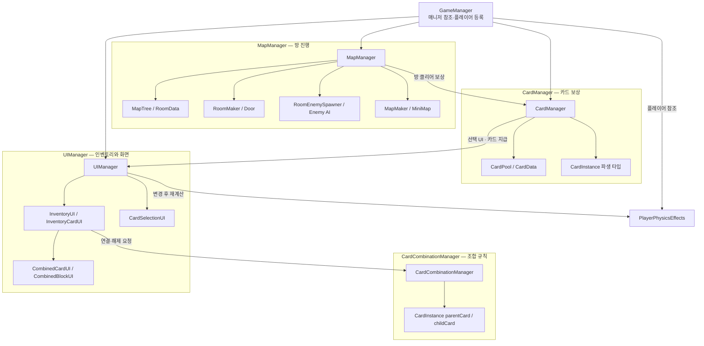
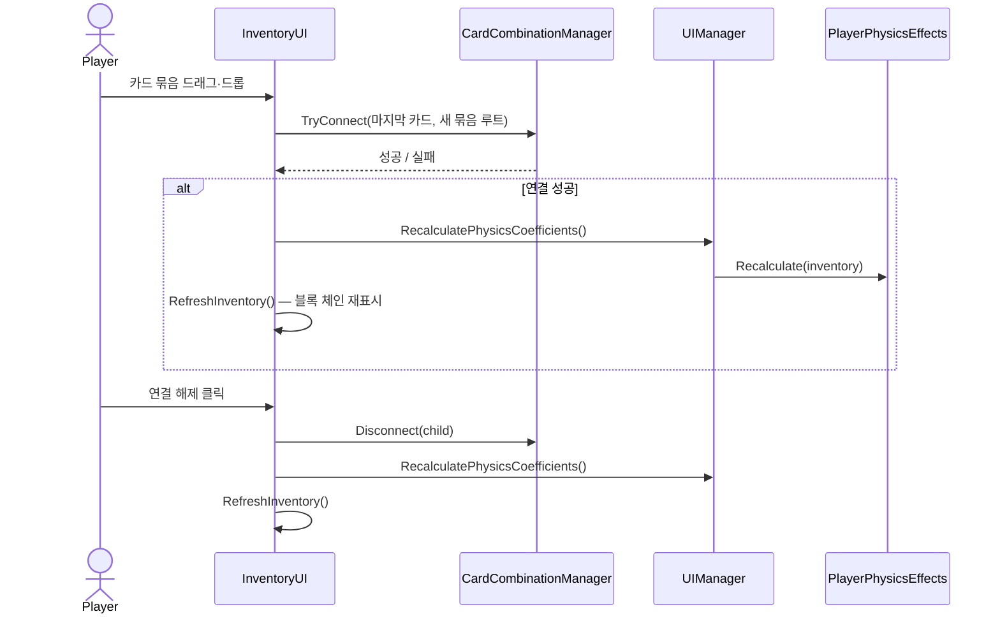

# PatchNote — 프로그램 구조 설계

> **기준:** GitHub `master` (`8a0e951`, 2026-11-28 확인) 및 `SampleScene.unity`의 계층 구조  
> **문서 목적:** **매니저를 기능의 소유자이자 실행 주체로 정의**하고, 각 매니저가 관리하는 하위 시스템·데이터·실행 흐름을 한곳에서 확인한다.  
> **표기:** **현행** = 저장소에서 확인한 코드·씬 / **목표** = 아직 구현·검증이 필요한 설계. 코드 존재와 Unity Play Mode 동작 검증은 다르다.

## 1. 설계 원칙 — 기능은 매니저 아래에서 움직인다

`GameManager`는 게임의 최상위 참조·플레이어 등록을 담당한다. 실제 게임 기능은 **기능별 매니저가 시작하고 조정**하며, 하위 클래스는 그 기능의 데이터를 계산하거나 화면에 표시한다. 기능 목록을 독립적으로 나열하기보다 **누가 시작하고, 무엇을 소유하며, 누구에게 위임하는가**로 구조를 읽는다.

| 기능의 주인 | 현행 책임과 주요 진입점 | 관리·호출하는 구성 요소 |
|---|---|---|
| `GameManager` | 싱글턴 참조, 플레이어 등록(`RegisterPlayer`), 매니저 접근점 | `MapManager`, `CardManager`, `UIManager`, `Playercontroller`, `PlayerPhysicsEffects` |
| `MapManager` | 맵 초기화(`InitializeMap`), 방 전환(`SetCurrentRoom`), 클리어(`ClearStage`), 보상 발생 요청 | `MapTree`, `RoomData`, `RoomMaker`, `RoomEnemySpawner`, `MapMaker`, `MiniMap`, `Door`, `CardManager` |
| `CardManager` | 방별 카드 풀, 후보 생성(`ShowCardSelection`), 인스턴스 생성, 보상 확정(`SendCard`) | `CardPool`, `CardData`, `CardInstance` 파생 타입, `UIManager` |
| `CardCombinationManager` | 조합 허용 규칙(`TryConnect`), 부모/자식 연결, 순환 방지, 분리(`Disconnect`) | `CardCombinationRule`, `CardInstance` 체인; `InventoryUI`가 이 매니저를 호출 |
| `UIManager` | 보유 카드 목록, 인벤토리/보상 화면, 일시정지, 적용 수치 재계산 | `InventoryUI`, `InventoryCardUI`, `CombinedCardUI`, `CombinedBlockUI`, `ScratchBlockGraphic`, `CardSelectionUI`, `PlayerPhysicsEffects` |

> `RoomMaker`나 `RoomEnemySpawner` 같은 이름도 내부 기능을 관리하지만, **게임 진행의 소유자**는 `MapManager`다. `Playercontroller`와 `PlayerPhysicsEffects`는 플레이어의 입력·물리 실행기이며 `GameManager`가 그 참조를 제공한다. 여기서의 소유 관계는 Unity `Transform`의 부모-자식 관계와 동일한 의미가 아니다.

### 매니저 중심 의존 관계



화살표는 **개념적인 호출·접근 방향**이며 매니저 객체의 Unity 계층을 나타내지 않는다. `CardEffectEvaluator`는 현재 없는 **목표 시스템**이므로 이 현행 그림에서는 제외했다.

## 2. GameManager — 실행 맥락과 플레이어 참조

**역할:** 다른 매니저가 플레이어와 최상위 기능에 접근할 수 있도록 게임 실행 맥락을 제공한다. 모든 세부 처리를 직접 구현하는 거대한 관리자 역할은 피한다.

- **현행 상태:** `Instance` 싱글턴, `mapManager`·`cardManager`·`uiManager` 참조, `RegisterPlayer(Playercontroller)`, `PlayerPhysics` 접근 프로퍼티.
- **시작 흐름:** `MapManager.InitializeMap()`가 플레이어 프리팹을 생성 → `GameManager.RegisterPlayer()` → `PlayerPhysicsEffects` 등을 조회할 수 있게 됨.
- **수명 주기:** `GameManager`에 `DontDestroyOnLoad(gameObject)`가 있으나 다른 매니저가 동일하게 영속화되는 것은 아니다. 씬 전환 시 참조 재연결 정책이 필요하다.
- **목표:** 씬을 넘는 게임 상태와 씬 단위 매니저 수명 주기를 명확히 분리한다.

## 3. MapManager — 맵·방·전투 진행을 묶는 관리자

`MapManager`는 방 진행의 **단일 오케스트레이터**다. 직접 타일을 칠하거나 적 AI를 실행하는 대신 담당 구성 요소를 호출한다.

| MapManager가 시작하는 기능 | 담당 하위 요소 | 현행 설명 |
|---|---|---|
| 맵 그래프 생성·시작 방 선택 | `MapTree` | `GenerateMap()` → `GetRooms()` → `GetStartNode()` |
| 방별 상태 조회·복원 | `RoomData`, `roomDataDictionary` | `isCleared` 등을 노드별로 보관; `PrepareRoomState()` |
| 방 지형·문 생성 | `RoomMaker`, `Door`, Tilemap | `GenerateRoom(currentNode)`와 `SetAllDoorsOpen()` |
| 플레이어 배치·이동 | `GameManager`, `Playercontroller` | 시작 방에서는 프리팹 생성·등록, 이후 `SetCurrentRoom()`에서 위치 이동 |
| 적 생성·제거·전멸 통지 | `RoomEnemySpawner`, `EnemyController`, `EnemyLife` | `SpawnCurrentRoomEnemies()`, `AllEnemiesDefeated` 이벤트 구독 |
| 클리어·문 개방·보상 요청 | `RoomData`, `CardManager` | `ClearStage()`에서 상태를 저장하고 `ShowCardSelection()` 요청 |
| 지도 UI 초기화 | `MapMaker`, `MiniMap` | 시작 시 `GenerateMapUI(mapNodes, currentNode)` 호출; 미니맵 갱신은 일부 미구현 |

### 현행 실행 순서

```text
MapManager.Start
  └─ InitializeMap
      ├─ MapTree.GenerateMap / 시작 노드 선택
      ├─ PrepareRoomState (시작 방 클리어 처리)
      ├─ RoomMaker.GenerateRoom
      ├─ 플레이어 프리팹 생성 → GameManager.RegisterPlayer
      ├─ SpawnCurrentRoomEnemies (시작 방은 클리어 상태이므로 생략)
      └─ MapMaker.GenerateMapUI

Door 등의 요청 → MapManager.SetCurrentRoom(targetNode)
  ├─ 이전 방 적 정리
  ├─ 노드 변경 / PrepareRoomState
  ├─ RoomMaker.GenerateRoom
  ├─ 플레이어 위치 갱신
  └─ 미클리어 방이면 적 생성
       └─ 전멸 이벤트 → ClearStage → 문 개방 → CardManager.ShowCardSelection
```

### 목표와 제약

- 방 전환은 **현행 `SetCurrentRoom`**, 문 상호작용을 통한 양방향 복원 API `TryEnterRoom(targetNode, fromNode)`는 **제안**이다. 현행 API와 혼동하지 않는다.
- 이미 클리어한 방은 적·보상 중복이 없어야 한다. **목표:** `RoomData`에서 생성·클리어·보상 수령 상태를 각각 관리한다.
- 지형 생성은 `RoomMaker`가 소유하며, 플랫폼의 두께·연결성·점프 가능성 검사는 **개발 목표**다. 현재 검증 완료로 기재하지 않는다.
- 적이 플랫폼 끝에서 떨어지지 않도록 하는 지형 감지는 `EnemyController` 등의 실행 책임이다. `MapManager`에 AI 로직을 넣지 않는다.

## 4. CardManager — 보상 후보와 카드 인스턴스 생성

**역할:** 현재 방의 `CardPool`에서 후보를 뽑아 **각 카드의 런타임 인스턴스**를 만들고 선택 결과를 전달한다.

- `ShowCardSelection(node)`: 노드 종류에 따라 `commonPool`·`hardPool`·`elitePool`·`rewardPool`·`bossPool` 중 하나를 선택한다.
- `GenerateCards(pool)`: 가중치에 따라 최대 3장의 후보를 만들고 동일 `CardData`의 중복 선정을 제거한다.
- `GenerateCardInstance(data)`: `NumberCardInstance`, `PhysicsCardInstance`, `StatCardInstance`, `SpecialCardInstance`를 생성한다. `TargetCardInstance` 타입은 있지만 `TargetCardData`가 없어 **현재 보상 생성 대상이 아니다**.
- `SendCard(index)`: 선택된 인스턴스를 `GameManager.Instance.uiManager.AddCard(instance)`로 보내고 카드 선택 화면을 닫는다.

### 매니저가 관리하는 카드 데이터

```text
CardData (ScriptableObject 템플릿)
  ├─ NumberCardData
  ├─ PhysicsCardData
  ├─ StatCardData
  └─ SpecialCardData

CardInstance (추상 클래스, 인스턴스 공통 데이터)
  ├─ NumberCardInstance (연산자·숫자값)
  ├─ PhysicsCardInstance (물리 종류)
  ├─ StatCardInstance (능력치 종류)
  ├─ SpecialCardInstance (특수 효과 종류)
  └─ TargetCardInstance (대상; 현재 생성 미연결)
```

`CardData`와 `CardInstance`를 구별한다. **합성은 기존 인스턴스를 연결하는 것**이며 새로운 합성용 원본 인스턴스를 생성하지 않는다.

## 5. CardCombinationManager — 카드 연결의 규칙 소유자

`InventoryUI`는 사용자의 드롭·분리 입력을 이 매니저에게 전달한다. **연결 가능성 판단과 `parentCard`·`childCard` 갱신은 `CardCombinationManager`의 책임**이다.

- **현행 규칙:** `Physics → Number`, `Stat → Number`, `Number → Number` (`CardOption` 플래그로 검사).
- `TryConnect(parent, child)`: null·자기 자신·이미 연결된 부모/자식·순환·허용 규칙을 검사하고 연결한다.
- `Disconnect(child)`: 전달받은 카드와 앞 카드의 연결을 해제한다. `A → B → C`에서 `B`를 분리하면 `A`와 `B → C`가 된다.
- **UI의 책임:** 합성된 **묶음의 마지막 카드**를 실제 부모로 선택하고, 조합 결과에 맞춰 표시를 갱신한다.
- **목표:** `Target → Physics` 조합은 아직 허용되지 않는다. Target 카드에 따른 적용 주체 변경과 규칙 확장은 별도 작업이다.

## 6. UIManager — 인벤토리·보상 창·시각화를 묶는 관리자

`UIManager`는 **현재 카드 인벤토리 데이터와 화면 전환의 책임 주체**다. 하위 UI 컴포넌트는 화면 구성·입력 이벤트를 담당한다.

| UIManager의 기능 | 하위 구성 요소 | 현행 처리 |
|---|---|---|
| 카드 보유 목록 | `List<CardInstance> inventory` | `AddCard(instance)`로 인스턴스 추가 |
| 인벤토리 열기·닫기 | `InventoryUI`, `InventoryCardUI` | `ToggleInventory()`로 표시와 시간 정지/복구 |
| 합성 체인 시각화 | `CombinedCardUI`, `CombinedBlockUI`, `ScratchBlockGraphic` | 루트 체인을 하나의 블록 묶음으로 표시하고 색상·연산값을 보여줌 |
| 연결·분리 입력 | `InventoryUI` → `CardCombinationManager` | 드롭·해제 후 UI 갱신 요청 |
| 카드 보상 화면 | `CardSelectionUI` | `ShowCardSelection`, `CloseCardSelection` |
| 카드 효과 반영 요청 | `PlayerPhysicsEffects` | `RecalculatePhysicsCoefficients()`에서 현행 인벤토리를 전달 |

### 인벤토리 합성 흐름



- 화면의 블록 모양은 **`ScratchBlockGraphic`**, 한 줄의 카드 내용과 해제 버튼은 **`CombinedBlockUI`**, 여러 블록의 묶음은 **`CombinedCardUI`**, 드래그·인벤토리 목록은 **`InventoryCardUI`·`InventoryUI`**가 맡는다.
- `CardInstance` 체인은 **최대 부모 1명·자식 1명의 선형 관계**이며 UI 계층은 그 구조의 표시물이다.
- **주의:** 이 코드는 저장소에 반영되었지만 Unity 화면에서 홈·돌기·레이아웃·중간 분리·클릭 동작을 회귀 테스트했는지는 별도 확인이 필요하다.
- **향후 고려:** 인벤토리의 저장·복원 및 상점·덱 시스템이 커지면 데이터 책임을 `InventoryManager` 등으로 분리할지 결정한다. 현재는 임의로 옮기지 않는다.

## 7. 물리 효과·플레이어 실행 — 매니저 아래의 수행 요소

**현행:** `UIManager`가 갱신을 요청하고 `PlayerPhysicsEffects`가 인벤토리 체인으로부터 플레이어의 이동 속도·점프력·중력·마찰·탄성 등을 재계산한다. `Playercontroller`는 계산 결과를 읽어 실제 이동·점프를 수행한다.

**목표:** `CardEffectEvaluator`(체인 해석·수치 계산)와 적용기(`EffectApplier` 또는 플레이어/적 적용 컴포넌트)를 분리해, UI 없이도 계산을 테스트할 수 있게 만든다. 현재 `EnemyTarget → GravityScale → ×2` 및 맵 전체 물리 적용이 구현됐다고 간주하지 않는다.

```text
현행: UIManager → PlayerPhysicsEffects(계산 + 플레이어 적용) → Playercontroller
목표: CardInstance 체인 → CardEffectEvaluator → 대상별 EffectApplier
```

## 8. 실제 Unity 씬 계층 구조 (현행)

`SampleScene.unity`에서 확인한 상위 배치다. **소스 코드의 책임 분류**와 **Hierarchy의 물리적 소속**을 구분한다.

```text
SampleScene
├── PersistentSystems
│   └── GameManager
├── Managers
│   ├── MapManager       (같은 GameObject의 MapTree/RoomMaker 등 컴포넌트 포함 가능)
│   ├── CardManager
│   ├── CardCombinationManager
│   └── UIManager
├── UIRoot
│   ├── Grid
│   │   └── GameMap
│   ├── MiniMap
│   │   ├── MapCanvas
│   │   ├── MiniMapCamera
│   │   └── RealMiniMapCanvas
│   └── CardUI
├── EnemySpawner
│   └── EnemyContainer
├── Global Light 2D
└── EventSystem
```

**주의 사항:** `EnemySpawner`는 **현재 최상위 오브젝트**다. 다음 Hierarchy 개선 단계에서 `Managers` 또는 `World` 아래로 이동할지는 실제 참조와 생명주기를 검사한 뒤 결정한다. `Player`는 `MapManager`가 런타임에 생성하므로 상위 씬 목록에 미리 나타나지 않을 수 있다.

## 9. 문서·코드 운영 규칙

- 새 기능을 설명할 때 **매니저 → 기능 → 하위 실행기·데이터 → 진입점 → 테스트** 순서로 적는다.
- 매니저 간 호출 방향을 변경할 때 반드시 본 문서의 의존 관계와 진입점을 수정한다.
- `TryConnect`, `GenerateRoom`, `ClearStage`처럼 상태를 실제로 변경하는 책임은 한곳에 둔다.
- 실제 코드와 목표 설계를 구분하고, 구현 여부는 [`REFACTOR_ROADMAP.md`](REFACTOR_ROADMAP.md) 체크리스트로 추적한다.
- Git 커밋 제목은 **`[작업 종류] 세부 내용`** 형식을 따른다. 예: `[Update Docs] 리팩터링 체크리스트와 매니저 책임 정리`.
- 원격 저장소 수정이나 PR 작성은 기본 작업 방식이 아니다. 변경 파일을 로컬에서 검토·테스트한 뒤 사용자가 직접 Commit·Push한다.
