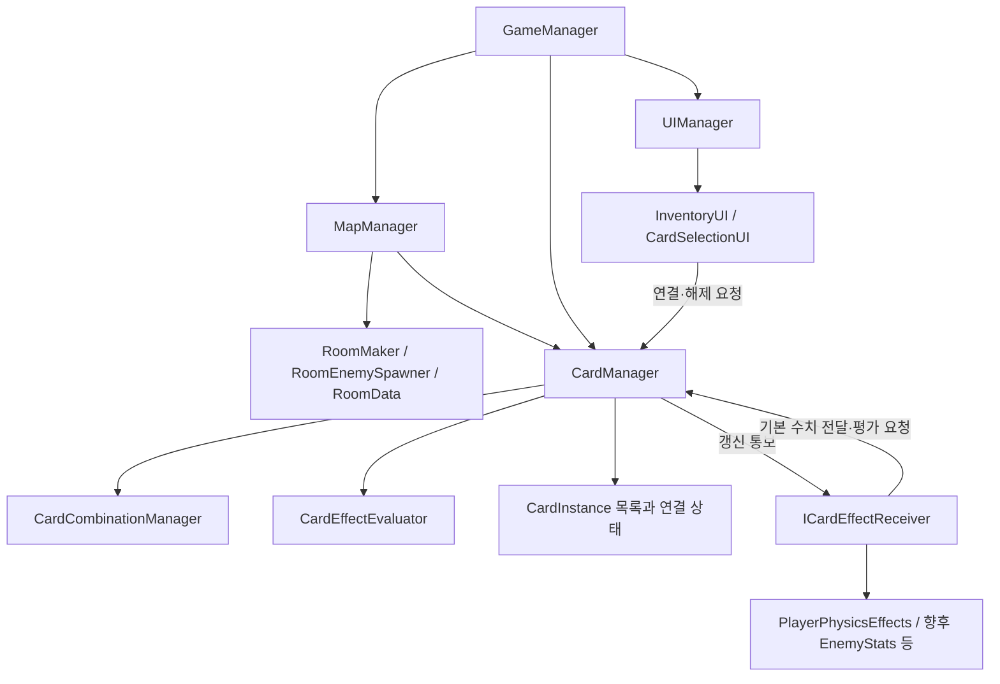
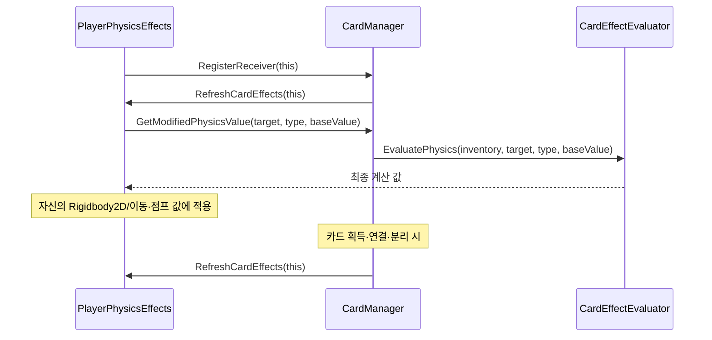

# PatchNote — 프로그램 구조 설계

> **설계 기준:** 2026-11-28 카드 매니저 책임 개편 · 게임 코드 PR #2 (`refactor/card-state-effect-lifecycle`) 
> **상태:** 아래 카드 시스템 구조는 **PR 제안 코드 기준**이다. `master`의 실제 코드에는 PR 병합 전까지 반영되지 않는다. Unity Play Mode 검증도 아직 완료하지 않았다.
> **원칙:** 기능별 매니저가 외부 진입점을 제공하고, 하위 구성 요소가 세부 작업을 맡는다. 수치의 소유자와 카드 계산기는 분리한다.

## 1. 매니저 중심 책임 구조

| 매니저 | 소유·조정하는 책임 | 하위 구성 요소 / 호출 대상 |
|---|---|---|
| `GameManager` | 최상위 실행 맥락, 플레이어 등록, 매니저 참조 | `MapManager`, `CardManager`, `UIManager`, 플레이어 |
| `MapManager` | 맵 생성, 방 전환, 적·클리어·보상 흐름 | `MapTree`, `RoomData`, `RoomMaker`, `RoomEnemySpawner`, `MapMaker`, `MiniMap`, `Door` |
| `CardManager` | 카드 상태의 유일한 소유, 카드 생성·획득, 연결·해제 진입점, 카드 효과 계산 요청 및 갱신 통보 | `CardCombinationManager`, `CardEffectEvaluator`, `CardPool`, `CardInstance`, `ICardEffectReceiver` |
| `UIManager` | 인벤토리 표시, 카드 선택 화면, 일시정지 및 UI 수명주기 | `InventoryUI`, `CardSelectionUI`, `CombinedCardUI`, `ScratchBlockGraphic` |

`CardCombinationManager`는 **별도 C# 클래스 / Unity 컴포넌트**로 유지하지만, 외부 시스템에서는 `CardManager.TryConnect`와 `CardManager.Disconnect`를 통해 접근한다. 이는 C# 상속 관계가 아니라 **구성(composition)과 위임**이다.



## 2. CardManager — 카드 데이터와 규칙의 단일 소유자

### 보유 상태

- `CardData`는 ScriptableObject **템플릿**이다. 카드의 개별 연산값이나 연결 상태를 템플릿에 기록하지 않는다.
- `CardInstance`는 **획득한 개별 카드**다. 파생 타입에 연산자, 숫자, 속성, 대상 등이 있고 `parentCard` / `childCard`는 선형 연결을 표현한다.
- `CardManager.inventory : List<CardInstance>`만 보유 카드의 권위 있는 원본이다. UI에서 같은 리스트를 별도로 소유하지 않는다.
- 인벤토리는 **모든 원본 인스턴스**를 유지한다. 합성·분리로 새 원본 카드가 만들어지지 않는다.
- **인벤토리의 루트 순서 = 동일한 대상·속성을 수정하는 여러 카드 체인의 적용 순서**. 한 체인 안에서는 루트에서 자식으로 순차 연산한다. UI 역시 같은 루트 순서를 표시한다.
- `CardManager`는 최종 물리·스탯 수치를 저장하지 않는다. 각 수치의 원본과 최종 적용값은 대상 객체의 컴포넌트가 소유한다.

### 카드 관리 진입점

| 외부 요청 | CardManager의 처리 | 위임 대상 |
|---|---|---|
| 보상 후보 요청 | 방 타입별 카드 풀 선택·인스턴스 생성 | `CardPool`, 파생 `CardInstance` |
| 카드 획득 | 단일 목록 추가, 목록 변경 통지, 효과 갱신 | `InventoryChanged`, 수신자 목록 |
| 카드 연결 | 보유 카드 확인 후 규칙 검사·체인 연결 | `CardCombinationManager.TryConnect` |
| 카드 분리 | 보유 카드 확인 후 체인 연결 해제 | `CardCombinationManager.Disconnect` |
| 최종 값 요청 | 대상·속성·기본값을 입력받고 연결된 연산 적용 | `CardEffectEvaluator.EvaluatePhysics` |
| 수신 객체 등록 | 등록 즉시 현재 카드 상태를 평가·초기화 | `ICardEffectReceiver.RefreshCardEffects` |

## 3. 카드 효과 계산 및 이벤트 수명주기

카드 효과를 받는 컴포넌트는 `ICardEffectReceiver`를 구현한다. 이 인터페이스는 상태 저장소가 아니며, **현재 상태 적용을 위한 공통 계약**이다.



- **최초 등록 시 1회 초기화**: 객체가 생성되면 기존 카드 상태를 적용한다. 카드 연결이 없는 경우 기본값이 사용된다.
- **변경 시 알림**: 카드의 획득·연결·해제 시 관련 대상의 수신자를 갱신한다. PR #2의 현재 구현은 Player와 Enemy 수신 그룹 모두를 갱신하는 단순한 1차 방식이다.
- **해제 시 정리**: `OnDisable` 등에서 등록을 해제한다. 동일 수신자의 중복 등록을 피한다.
- **계산 순서**: 카드를 획득한 리스트 순서로 루트 체인을 순회하며 같은 속성의 결과를 누적한다. `×2` 후 `+3`과 `+3` 후 `×2`는 다르므로 UI 순서도 중요하다.
- **대상 정책**: 현재 구현에서 Target 카드가 없는 기존 Physics 체인은 Player에 적용한다. World/전체 적, 특정 적의 식별, Target 카드의 실제 보상 생성은 미완성이다.
- **값의 위치**: 기본 이동 속도·점프력·중력·마찰·탄성은 `PlayerPhysicsEffects`가 관리한다. `CardEffectEvaluator`는 수정 규칙만 계산한다.

## 4. 데이터 수명과 직렬화

- `CardManager`는 씬 루트로 분리한 뒤 `DontDestroyOnLoad`로 씬 전환 중 목록을 유지하도록 구성한다.
- 보유 목록은 `[SerializeReference]`를 적용하고 연결 필드에도 관리 참조를 사용한다. 추상 `CardInstance` 파생 타입과 연결 객체의 정체성을 **동일한 직렬화 호스트 내에서** 보존하려는 목적이다.
- `[SerializeReference]` 자체는 실행 중 수정된 카드를 게임 종료 후 저장하는 기능이 아니다. 영구 세이브는 추후 카드 고유 ID, 카드별 값, 연결 카드 ID, 루트 적용 순서 등을 파일로 기록해야 한다.
- `CardCombinationManager`는 조합 규칙 데이터를 유지한 채 `CardManager`의 하위 구성 요소로 이동한다. 기존 Inspector 규칙을 삭제하지 않도록 주의한다.
- 씬 전환 시 영속 `CardManager`와 씬 범위의 `MapManager`·`UIManager` 간 참조를 다시 확인해야 한다. 씬 재로드 및 중복 매니저 생성에 대한 Play Mode 검증이 필수다.

## 5. UIManager — 화면 책임만 유지

- `InventoryUI`는 `CardManager.Inventory`를 읽어 단일 카드 또는 선형 체인을 블록으로 표시한다.
- 드래그·드롭은 `InventoryUI` → `CardManager.TryConnect` → `CardCombinationManager` 경로로 수행한다.
- 연결·해제 후 `CardManager.InventoryChanged`가 발생하면 열린 인벤토리 화면을 재생성한다. 드래그 중에는 종료 시점까지 화면 갱신을 보류한다.
- 보상 선택 화면의 열기·닫기, 시간 정지·복구는 `UIManager`에 남긴다. 카드 획득의 실제 기록은 `CardManager.AddCard`가 수행한다.
- `InventoryCardUI`, `CombinedCardUI`, `CombinedBlockUI`, `ScratchBlockGraphic`은 데이터를 복제하거나 카드 효과를 계산하지 않는다.

## 6. MapManager와 GameManager — 다른 매니저와의 관계

- `GameManager`는 플레이어 등록과 최상위 매니저 참조를 제공한다. 개별 카드 연산·방 지형 로직은 포함하지 않는다.
- `MapManager`는 방 생성·진행의 주체로 남고, `RoomMaker`가 지형, `RoomEnemySpawner`가 적 생성·전멸 통지를 맡는다.
- 방 클리어 시 `MapManager`는 `CardManager.ShowCardSelection`을 호출하고, 카드가 선택되면 `CardManager`가 인스턴스를 보유 목록에 추가한다.
- 플레이어 또는 적이 등장하면 효과 수신자가 `CardManager`에 등록해 현재 카드 상태를 적용한다. 적 효과 수신자는 **확장 목표**이며 PR #2에서 직접 구현되지는 않았다.

## 7. 변경과 검증 경계

- PR #2는 **코드 변경 제안**이다. Unity 6000.4.0f1 실제 컴파일·씬 재입장·연결/분리·인스펙터 참조 테스트는 아직 수행하지 않았다.
- 카드 목록이 `UIManager`에서 제거되므로 이전 씬의 직렬화 필드에 저장된 실제 카드가 있었다면 별도 데이터 이전이 필요하다. 이번 확인 시점의 `SampleScene` 인벤토리 목록은 비어 있다.
- `GameManager`에서 현재 플레이어를 조회하는 방식과 신규 수신자 초기화 순서를 함께 검증한다.
- 장기 작업: 대상 카드의 생성·적용 범위, 효과 종류 확장, 저장 파일 포맷, 효과 순서 UI, 중복 지속 매니저 정리.

## 8. 실제 Unity 씬 계층 구조 (현행)

`SampleScene.unity`에서 확인한 상위 배치다. **소스 코드의 책임 분류**와 **Hierarchy의 물리적 소속**을 구분한다.

```text
SampleScene
├── PersistentSystems
│   └── GameManager
├── Managers
│   ├── MapManager       (같은 GameObject의 MapTree/RoomMaker 등 컴포넌트 포함 가능)
│   ├── CardManager
│   ├── CardCombinationManager
│   └── UIManager
├── UIRoot
│   ├── Grid
│   │   └── GameMap
│   ├── MiniMap
│   │   ├── MapCanvas
│   │   ├── MiniMapCamera
│   │   └── RealMiniMapCanvas
│   └── CardUI
├── EnemySpawner
│   └── EnemyContainer
├── Global Light 2D
└── EventSystem
```

**주의 사항:** `EnemySpawner`는 **현재 최상위 오브젝트**다. 다음 Hierarchy 개선 단계에서 `Managers` 또는 `World` 아래로 이동할지는 실제 참조와 생명주기를 검사한 뒤 결정한다. `Player`는 `MapManager`가 런타임에 생성하므로 상위 씬 목록에 미리 나타나지 않을 수 있다.

## 9. 문서·코드 운영 규칙

- 새 기능을 설명할 때 **매니저 → 기능 → 하위 실행기·데이터 → 진입점 → 테스트** 순서로 적는다.
- 매니저 간 호출 방향을 변경할 때 반드시 본 문서의 의존 관계와 진입점을 수정한다.
- `TryConnect`, `GenerateRoom`, `ClearStage`처럼 상태를 실제로 변경하는 책임은 한곳에 둔다.
- 실제 코드와 목표 설계를 구분하고, 구현 여부는 [`REFACTOR_ROADMAP.md`](REFACTOR_ROADMAP.md) 체크리스트로 추적한다.
- Git 커밋 제목은 **`[작업 종류] 세부 내용`** 형식을 따른다. 예: `[Update Docs] 리팩터링 체크리스트와 매니저 책임 정리`.
- 원격 저장소 수정이나 PR 작성은 기본 작업 방식이 아니다. 변경 파일을 로컬에서 검토·테스트한 뒤 사용자가 직접 Commit·Push한다.
