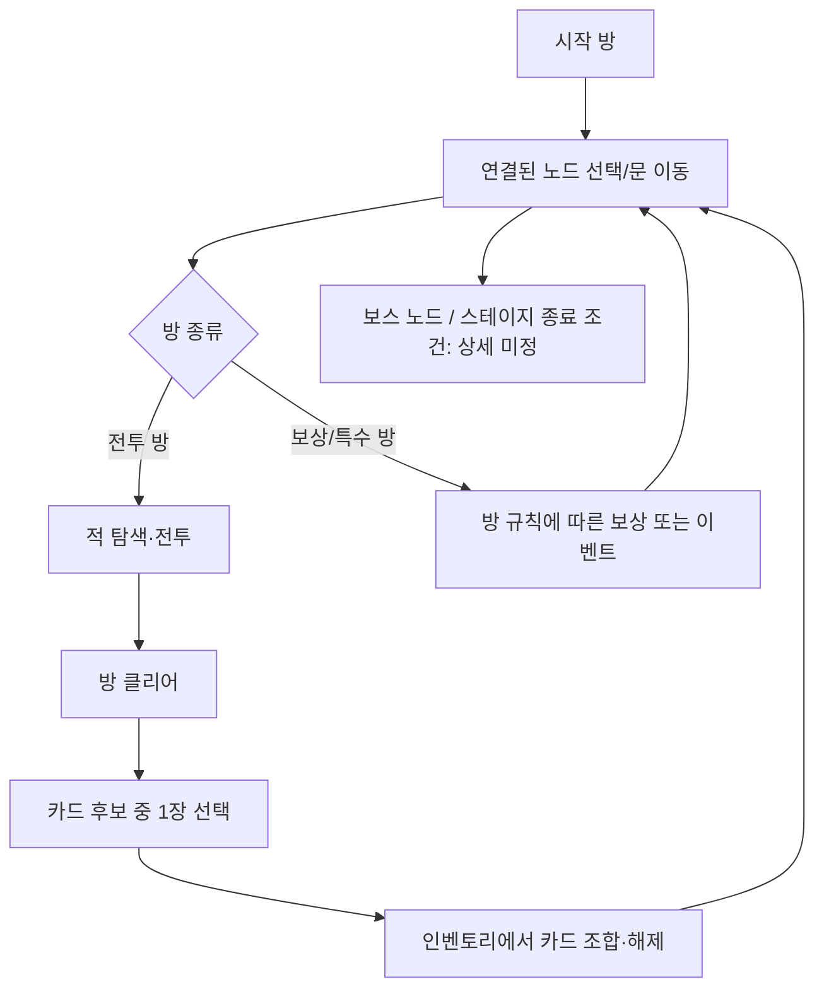

# PatchNote — 게임 기획서 (Game Design Document)

> **문서 버전:** GDD 0.1 · 2026-11-24  
> **프로젝트:** [junsik316/PatchNote](https://github.com/junsik316/PatchNote)  
> **문서 목적:** 개발 현황을 보고하는 README와 별개로, **게임이 궁극적으로 어떤 규칙으로 작동해야 하는지** 정의하고 카드·무기·적·방 콘텐츠의 구현 누락을 방지한다.  
> **근거:** 2026-11-24에 확인한 GitHub `master`의 소스/씬/ScriptableObject와 개발 대화에서 확정한 기획.  
> **표기:** **확정** = 기획 방향이 정해짐 / **현행** = 현재 코드에 기능 또는 정의가 존재 / **예정** = 추가하기로 함 / **미정** = 세부 정책 결정 필요. 이 상태들은 서로 배타적이지 않다.

## 1. 게임 개요

| 항목 | 내용 | 상태 |
|---|---|---|
| 제목 | PatchNote | 현행 |
| 장르 | 2D 플랫폼 액션 + 로그라이크 + 카드 조합/덱 빌딩 | 확정 |
| 핵심 콘셉트 | 프로그래머가 게임 세계에 나타난 버그와 싸우며, **게임의 물리·능력치 규칙을 카드처럼 조합해 수정**한다 | 확정된 방향 |
| 주요 특징 | 전투 보상으로 획득한 카드의 연결 순서가 실제 이동·중력 등 게임의 규칙을 바꾼다 | 확정 |
| 시점/화면 | 2D 횡스크롤 플랫폼 진행 | 현행 |
| 승리 조건 | 맵 그래프에서 방을 진행하고 보스 노드까지 도달하는 구조를 기준으로 설계 | 방향 확정, 세부 엔딩 미정 |
| 스토리 세부 설정 | 버그의 정체, 개발자 캐릭터의 배경, 스테이지별 서사 | 미정 |

### 1.1 핵심 디자인 원칙

1. **규칙 자체가 보상이다.** 카드 획득은 숫자 증가에 그치지 않고 조작감과 전략을 바꿔야 한다.
2. **카드 연결 순서가 의미를 갖는다.** 같은 카드여도 곱셈과 덧셈의 순서에 따라 결과가 달라진다.
3. **기본 상태로 게임을 진행할 수 있어야 한다.** 카드 효과가 없어도 필수 방과 출구를 이동할 수 있도록 맵을 검증한다.
4. **플레이어가 변경 사항을 이해할 수 있어야 한다.** 합성 카드 UI와 현재 물리 계수/적용 대상을 명확하게 보여준다.
5. **추가 콘텐츠는 기존 시스템을 크게 고치지 않고 확장한다.** 새로운 카드·무기·적을 추가해도 맵 관리자나 기본 UI의 수정은 최소화한다.

## 2. 한 번의 플레이 흐름



- **현행:** `MapTree`는 `common`, `hard`, `elite`, `reward`, `boss` 노드를 사용하고, `MapManager`는 방 이동과 클리어 상태를 관리한다.
- **현행:** 적이 모두 제거되면 문이 열리고 카드 선택으로 이어지는 흐름이 있다. 같은 방 재진입 시 클리어 기록을 재사용한다.
- **현행 테스트 전용:** `C` 키는 적 전체 처치 디버그 입력이며 정식 전투 메커니즘이 아니다.
- **미정:** 방 종류별 보상 차이, 게임 오버 이후 지속 성장 여부, 보스 클리어 후 다음 스테이지 구조.

## 3. 플레이어 조작과 물리

### 3.1 기본 동작

| 동작 | 기획 | 상태 |
|---|---|---|
| 좌우 이동 | 물리 효과로 수정된 이동 속도를 읽어서 움직임 | 현행, 충돌 리팩터링 필요 |
| 점프 | 물리 효과로 수정된 점프 힘을 읽어서 실행 | 현행, 접지 판정 개선 필요 |
| 달리기 | 일반 이동과 구별되는 속도 상태 | 현행 |
| 더블 점프 | `DoubleJump` 특수 카드와 연계 | 데이터 정의, 효과 미완성 |
| 공격 | 무기별 공격 방식 사용 | 예정, 상세 미정 |
| 인벤토리 | 카드 연결과 해제, 효과 확인 | 현행 UI 개선 필요 |
| 문 상호작용 | 접근 시 목적지 안내, 확인 키로 이동 | 예정 |

**입력 충돌 주의:** 현재 점프가 `Space`를 사용한다. 문 이동에도 `Space`를 사용할 경우, 문 상호작용 우선순위와 점프 입력 차단 규칙을 명확히 정해야 한다.

### 3.2 물리 안정성 요구사항

- 이동은 Rigidbody2D의 물리 갱신 흐름 안에서 수행하며 고속 이동 시 벽 관통을 막는다.
- 접지 여부는 충돌 진입 이벤트 한 번에만 의존하지 않고 지속적인 지면 검사를 사용한다.
- 카드 효과가 바뀔 때 기본값을 기준으로 재계산하고 **중복 적용하지 않는다**.
- `Playercontroller`는 카드 종류·카드 체인을 알지 않고 **완성된 물리 값만 조회**한다.
- 음수 중력·극단적 점프/속도·0으로 나누기 등 예외에 대한 정책은 별도로 결정한다.

## 4. 방과 맵

### 4.1 노드 종류

| 노드 | 역할 | 기획 상태 |
|---|---|---|
| Common | 기본 전투/기본 보상 | 현행 구조 |
| Hard | 더 강한 전투/보상 차등 | 구조 있음, 세부 규칙 예정 |
| Elite | 특수한 강적 및 보상 | 구조 있음, 세부 규칙 예정 |
| Reward | 보상 중심의 비전투 방 | 구조 있음, 보상 정책 미정 |
| Boss | 강력한 적/진행 마무리 | 구조 있음, 보스 전투 설계 미정 |
| Start | 플레이 시작, 기본적으로 자유 이동 | 현행 처리 |

### 4.2 방 생성·이동

- 방 구조는 플랫폼 목록과 문 연결 데이터를 바탕으로 생성하며, 재방문 시 같은 방의 지형을 유지한다.
- 클리어 기록은 해당 노드의 `RoomData.isCleared`에 보관한다.
- **예정:** 문과 접촉하자마자 이동하지 않고 목적지 노드를 표시한 뒤 상호작용 키로 이동한다.
- **예정:** 다음 방에서는 **이전 방으로 연결되는 문 근처**에 안전하게 출현한다.
- **예정:** 기본 이동·점프 능력으로 시작 지점부터 필수 출구까지 도달할 수 있는지 자동 검사한다.
- **예정:** 플랫폼은 1칸짜리 가로줄이 아니라 넓고 두꺼운 2D 블록형 지형으로 만들며, 중심점들을 연결해 자연스러운 실루엣을 만든다.
- **예정:** 적이 무작정 낙하하지 않도록 지형 가장자리·낙하 가능 여부를 판단한다.

### 4.3 방 영속 상태

- **현행:** 한 플레이 세션 내에서 생성 여부, 클리어 여부, 플랫폼 배치를 유지한다.
- **정책:** 재방문 시 클리어된 방은 적을 다시 생성하거나 카드 보상을 중복 지급하지 않는다.
- **미정:** 보상 표시·수령 상태의 독립 저장, 스테이지 간 세이브 파일 구조.

## 5. 적과 전투

### 5.1 적 AI 기본 상태

```text
Idle → (플레이어 감지) Chase → (공격 거리 진입) Attack
                     ↓                       ↓
            (추적 해제 거리) Idle      (공격 거리 이탈) Chase
```

- 감지 거리보다 추적 해제 거리를 크게 설정해 상태가 경계에서 반복 전환되는 것을 줄인다.
- 현행 적은 주로 수평으로 따라오는 형태다. 점프/경로 탐색/낭떠러지 회피는 별도 확장 대상이다.
- 노드별 적 종류와 수량은 `RoomEnemySpawner` 설정으로 관리한다.
- 테스트용 사망 처리와 실제 체력·무기 피해는 구분한다.

### 5.2 적 종류 계획

| 구분 | 특징 | 상태 |
|---|---|---|
| 기본 추적형 | 감지 → 추적 → 근거리 공격 | 현행 |
| 빠른 적 | 이동 속도와 추적 압박 차별화 | 후보 |
| 플랫폼 고정형 | 지형을 지키며 공격 | 후보 |
| 점프/플랫폼 이동형 | 높이 차이를 따라 이동 | 후보 |
| 엘리트/보스 | 고유 공격 및 패턴 | 예정, 상세 미정 |

위의 ‘후보’는 설계 제안으로, 실제 추가할 적 종류가 확정됐다는 뜻이 아니다.

### 5.3 플레이어 공격·무기

**무기 시스템은 아직 기획 세부사항이 정해지지 않았다.** 아래 항목을 구현 전에 확정한다.

- 무기 획득·교체 방식: 시작 무기 / 드롭 / 보상 / 상점 중 무엇을 사용할지
- 무기 구분 기준: 근접 / 투사체 / 특수형 중 무엇을 지원할지
- 공격 속도·사거리·피해 판정·경직·발사체 수명
- 카드로 변경한 `AttackPower`, `Defense`, 특수 효과와 무기 피해 계산의 관계
- 적 체력·무적 시간·피격 피드백과 보스 패턴

## 6. 카드 시스템 — 핵심 기획 목록

### 6.1 개념

- `CardData`: ScriptableObject로 만든 카드 종류별 **원본 템플릿**. 기존 정의는 유지한다.
- `CardInstance`: 플레이어가 획득한 **개별 카드의 실제 값**을 보관한다.
- 인벤토리는 보유한 **모든 원본 인스턴스**를 담는다. 합성은 원본 카드를 복제하지 않고 연결 관계만 바꾼다.
- 연결은 **부모 최대 1개, 자식 최대 1개인 일렬 체인**이다. 표시가 스크래치처럼 중첩되어도 데이터는 가지가 없는 연결이다.

### 6.2 카드 구현 누락 방지 마스터 목록

| ID | 카드 범주 / 인스턴스 | 실제 세부 정의 | 상태 | 연결·적용 계획 |
|---|---|---|---|---|
| C-01 | `NumberCardInstance` | ×, ÷, +, − / Integer, Decimal, Wild | 현행 생성, 타입 분리 예정 | 반드시 연산자와 수치 둘 다 보유 |
| C-02 | `PhysicsCardInstance` | MoveSpeed, JumpForce, GravityScale, Friction, Bounciness | 현행 일부 적용, 타입 분리 예정 | 숫자 연산 체인을 연결 |
| C-03 | `StatCardInstance` | MaxHealth, AttackPower, Defense | CardData 정의됨, 효과 미완성 | 숫자 연산 체인을 연결 |
| C-04 | `SpecialCardInstance` | DoubleJump, InvincibilityTime | CardData 정의됨, 카드 풀 미등록 | 연결·중첩 정책 미정 |
| C-05 | `TargetCardInstance` | Player, Enemy | 예정 | `EnemyTarget → GravityScale → ×2` 같은 앞쪽 주체 카드 |

**새 카드를 추가할 때:** 기존 종류의 새 `CardData` 에셋으로 충분한지, 새로운 `CardInstance` 파생 클래스가 필요한지 먼저 판정한다. 카드 종류마다 새로운 클래스가 필요한 건 아니다.

### 6.3 합성 규칙

**현재 허용 조합:** `Physics → Number`, `Stat → Number`, `Number → Number`.

**추가 예정:** `Target → Physics` (기존 물리 카드 루트 없이 대상 변경). `Target → Stat`, `Special → Number` 등의 조합은 아직 허용 여부를 정하지 않았다.

연결 규약:

1. 자기 자신과 연결 금지, 부모 자식 각 1개 제한, 순환 금지.
2. 카드 묶음 전체를 다른 카드에 연결 가능. 실제 연결은 체인 끝과 새 체인 루트 사이에서 발생.
3. 연결을 중간에서 해제하면 두 개의 독립된 체인으로 나뉜다.
4. 합성 카드 UI는 **한 묶음**으로 표시하되 각 구성 카드의 순서와 해제 지점을 알아볼 수 있어야 한다.
5. 연결/해제 시 카드 효과는 기본값에서 재계산한다.

### 6.4 효과 계산 규칙

예: 기본 이동 속도 5에 `MoveSpeed → ×2 → +3`을 연결하면 **(5 × 2) + 3 = 13**.

- 카드 순서는 왼쪽부터 오른쪽(루트부터 자식)으로 처리한다.
- 계산 결과와 적용은 분리한다. **CardEffectEvaluator**(예정)는 수치 계산을, **EffectApplier/PlayerPhysicsEffects**는 적용을 맡는다.
- `Playercontroller`는 최종 이동·점프 값만 조회한다.
- **예정:** 물리 적용 주체 카드가 없으면 플레이어에 적용. `EnemyTarget`이 앞에 있으면 적에게만 물리 효과 적용.
- **미정:** Enemy 대상이 모든 적인지, 범위/개별 대상인지; 음수 중력과 이동 불가능한 조합의 허용 범위; 특수 효과 중첩 규칙.

### 6.5 카드 보상·밸런싱

- 방 클리어 뒤 **후보 3장 중 1장**을 선택하는 흐름이 현행 코드에 있다. 카드 풀에서는 가중치 기반으로 추첨한다.
- `CommonPool` 하나를 여러 노드가 임시로 참조하는 것은 **개발 테스트 설정**이지 최종 밸런싱 의도가 아니다.
- 플레이 테스트 관찰: 약 **×2 부근은 체감이 크고, ×1.5 이하에서는 체감이 약했다**. 단, 중력 등 카드 속성에 따라 효과 체감이 다르므로 단일 기준으로 희귀도를 확정하지 않는다.
- **미정:** Common/Hard/Elite/Reward/Boss 간 보상 차이, 조합된 카드와 개별 카드의 등장/보관 한도, 수치 폭주 방지 정책.

### 6.6 신규 카드 추가 체크리스트

- [ ] 게임 기획서의 C-xx 항목(또는 새 ID)에 역할과 규칙 등록
- [ ] `CardData`/에셋 종류 확인 및 필요 시 추가
- [ ] 대응하는 `CardInstance` 타입 또는 기존 타입 재사용
- [ ] CardManager 생성 경로 지원
- [ ] 카드 풀 등록 여부 및 가중치 설계
- [ ] 개별 카드 UI와 합성 카드 UI 표시
- [ ] 연결 규칙/순환 방지/해제 후 체인 복원
- [ ] 효과 계산과 플레이어·적 적용 범위 테스트
- [ ] 보상 화면에서 실제 랜덤 생성값 표시
- [ ] 게임 진행/재방문/세이브 상황에서 값 유지 검토
- [ ] 개발 현황과 로드맵 상태 갱신

## 7. 화면과 UX

| UI | 현재 또는 목표 동작 | 상태 |
|---|---|---|
| 인벤토리 | 개별 카드·합성 카드 표시, 드래그 연결/해제 | 현행, 개선 필요 |
| 카드 선택 화면 | 후보 3장 표시, 획득 카드 선택 | 현행, 실제 랜덤값 미리보기 개선 필요 |
| 합성 카드 표시 | 스크래치 블록처럼 체인 순서와 결합부를 한눈에 표시 | 예정, 현재 표시/해제 오류 정리 필요 |
| 전체 지도 | 노드·연결 간선 표시 | 현행 |
| 미니맵 | 확대/축소 및 노드 hover 시 연결 간선 강조 | 개선 예정 |
| 문 안내 | 문 접근 시 이동할 노드 표시, 확인 키를 눌러 이동 | 예정 |
| 전투 HUD | 체력, 무기, 효과 상태 표시 | 요구사항 일부, 상세 미정 |

## 8. 게임 경제·성장·난이도 — 결정 필요

현재 기획에서 아직 정하지 않은 영역이다. 코드가 있다고 추측하여 확정하지 않는다.

- 재화/상점/카드 제거 또는 교체 기능의 존재 여부
- 한 번의 플레이(run) 종료·게임 오버·재시작 규칙
- 덱 구성 한도·카드 희귀도 단계·카드 풀의 분화 방식
- 적 공격력/체력, 방별 난이도 증가, 보스 보상
- 스테이지별 테마/환경 규칙과 영구 성장 여부

## 9. 기술 설계 원칙 (구현 방법의 계약)

| 시스템 | 주된 책임 |
|---|---|
| `GameManager` | 전체 시스템 접근점, 전체 실행 상태 |
| `MapManager` | 노드/방 이동·클리어·보상 트리거 |
| `RoomMaker` | 방 배치 데이터와 타일/문 생성 |
| `RoomEnemySpawner` | 적 종류·수량·배치 |
| `CardManager` | 카드 후보 생성·보상 선택 |
| `CardInstance` | 개별 카드별 상태·연결 관계 |
| `CardCombinationManager` | 카드 결합 가능 여부·연결/해제 |
| `CardEffectEvaluator` (예정) | 카드 연결을 읽어 수치/대상별 결과 계산 |
| `PlayerPhysicsEffects` | 계산된 물리 계수를 플레이어에 적용 |
| `Playercontroller` | 입력/이동, 최종값 참조만 담당 |
| `UIManager` / `InventoryUI` | 현행 인벤토리 소유와 화면 흐름 / 인벤토리 표시 |

**리팩터링 전략:** ① 카드 인스턴스 타입 분리 → ② 인벤토리 호환성 점검 → ③ 결합/해제 안정화 → ④ 효과 계산과 적용 분리 → ⑤ 새 카드·무기 확장. 카드 풀과 기존 `CardData`는 1차 작업에서 변경하지 않는다.

## 10. 기능 개발 로드맵과 연동

| 우선 단계 | 기획 기능 | 관련 로드맵 |
|---|---|---|
| 안정화 | 고속 이동 벽 관통 및 접지 판정 개선 | R-04, R-05 |
| 맵 진행 | 도달 가능한 플랫폼/문 상호작용/재입장 위치 | R-06, R-07, R-10, R-11 |
| 카드 기반 | 인스턴스 타입, 조합·해제, 효과 계산 | R-13 ~ R-18 |
| UX | 스크래치 UI, 미니맵 확대·강조 | R-15, R-16, R-19, R-20 |
| 콘텐츠 | 무기/적 유형 확대, 보상 밸런스 | R-22, R-23 및 추후 신규 이슈 |

## 11. 결정 대기 목록

| ID | 질문 | 결정 시 영향 받는 시스템 |
|---|---|---|
| D-01 | 게임의 최종 승리 조건/엔딩은 무엇인가? | 맵, 스테이지, 보스 |
| D-02 | 문과 점프가 모두 Space일 때 입력 우선순위는? | 플레이어, Door, UI |
| D-03 | 무기는 어떤 종류이며 어떻게 획득/교체하는가? | 전투, 보상, 인벤토리 |
| D-04 | 카드 수치의 허용 범위와 과도한 효과의 제한은? | 카드, 물리, 밸런스 |
| D-05 | 특수 카드도 숫자 카드와 결합 가능한가? | 카드 조합, 평가기 |
| D-06 | EnemyTarget은 모든 적에게 적용하는가? | 대상 평가, 적 스폰 |
| D-07 | Reward 노드는 어떤 고유 보상을 제공하는가? | 맵, 카드 풀 |
| D-08 | 플레이 종료 후 유지되는 데이터는 무엇인가? | 세이브, 성장 |

---

## 문서 운영 규칙

- **이 문서 `GAME_DESIGN.md`:** *무엇을 구현할지*, 게임 규칙, 콘텐츠 범위, 미정 정책의 기준.
- **`README.md`:** *실제로 무엇이 동작하는지* 개발 현황과 실행 방법.
- **`docs/ARCHITECTURE.md`:** *누가 어떤 책임으로 구현하는지* 클래스/의존 관계.
- **`docs/REFACTOR_ROADMAP.md`:** *언제 무엇을 고칠지* 우선순위/완료 조건.
- 기존 `CARD_DESIGN.md`는 카드 상세 규격의 하위 문서로 유지할 수 있지만, **카드 종류 목록의 최상위 인덱스는 이 기획서의 C-xx 표**로 관리한다.

> 새 카드를 추가하기 전에 C-xx 목록을 갱신하고, 새 적/무기/방 유형을 추가하기 전에 해당 섹션에 기획을 기록한다. 구현 후에는 README와 로드맵에 별도로 완료 여부를 기록한다.
